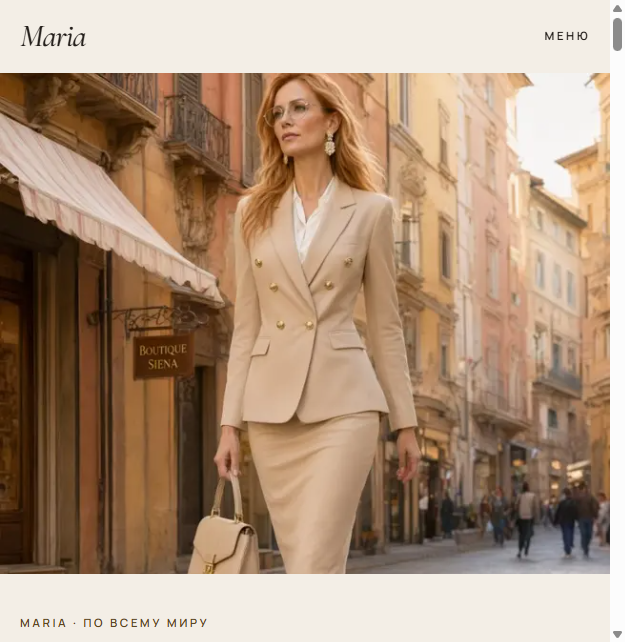
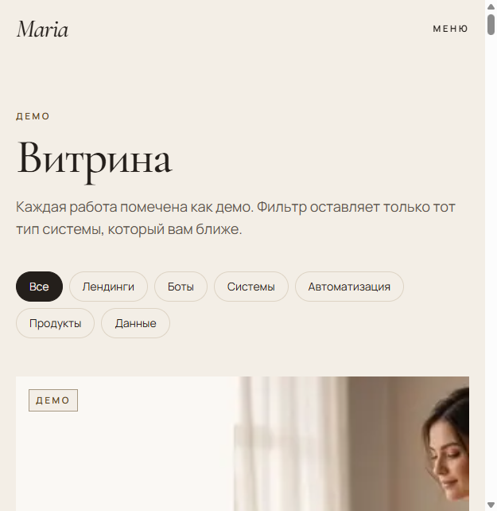
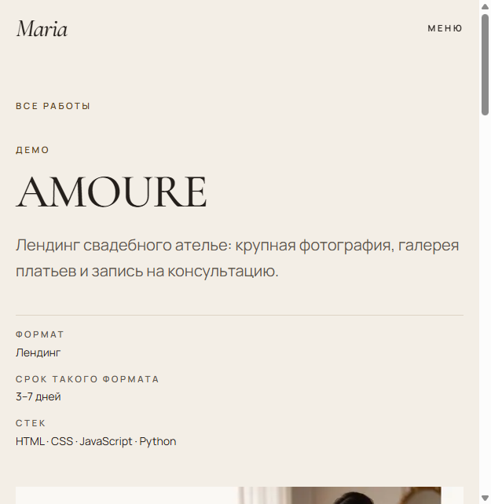
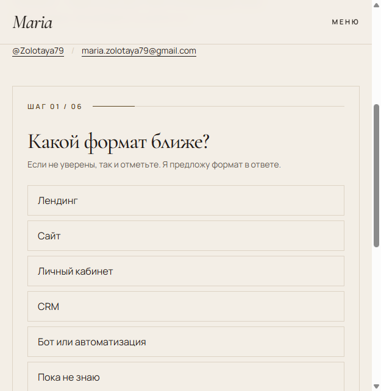

# Maria

Сайт-витрина Maria: продающие страницы, кабинеты, CRM, боты и автоматизация. Работа по всему миру, интерфейс на русском и английском. Все проекты на витрине помечены как демо. Живых отзывов нет: блок «Демо-отзывы» — это образцы тона, не цитаты заказчиков.

Стоимость на сайте не публикуется. Она рыночная и согласуется после оценки задачи.

## Как выглядит

Первый экран: портрет и оффер.

Витрина с фильтром по типу работы.

Карточка проекта: формат, срок такого формата, стек и кадры.

Анкета из шести шагов. После отправки открывается Telegram с готовым текстом, то же письмо готовится на почту. Сайт заявку не хранит.

## Страницы

| Адрес | Что там |
| --- | --- |
| `/` | Первый экран, избранные работы, форматы, подход, демо-отзывы |
| `/work` | Все демо-работы и фильтр |
| `/work/[slug]` | Кейс: задача, что собрано, что это меняет |
| `/start` | Анкета заказчика |
| `/privacy` | Как обрабатывается текст заявки |

## Стек

Next.js, React, TypeScript, Tailwind CSS. Шрифты Cormorant Garamond и Manrope.

Запуск, выкладка, новые проекты и контакты — в [инструкция.md](инструкция.md).
